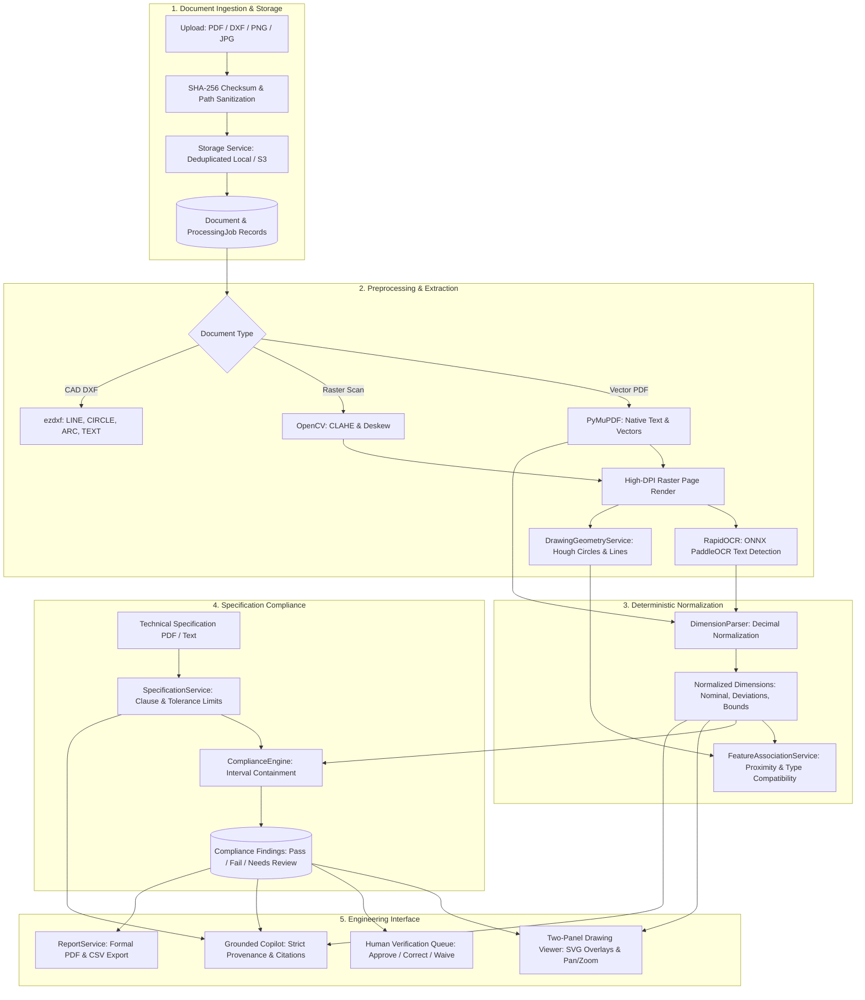

# Engineering Drawing Intelligence & Design Compliance Copilot

[](https://www.python.org/downloads/)
[](https://fastapi.tiangolo.com)
[](https://docs.pytest.org)
[](https://alembic.sqlalchemy.org)

An enterprise engineering document intelligence platform and compliance copilot. Designed for aerospace, automotive, and precision mechanical engineering teams, this system analyzes mechanical engineering drawings (PDF, DXF, PNG, JPG), extracts dimensions and tolerances, detects geometric features, associates callouts with drawing entities, and deterministically validates drawings against engineering specifications.

---

## 📐 System Overview & Value Proposition

In precision manufacturing, engineering drawings contain dozens or hundreds of critical tolerance intervals. An overlooked drawing discrepancy—such as specifying a shaft diameter tolerance of `⌀20 ±0.1 mm` `[19.9, 20.1]` when the contractual specification demands `⌀20 ±0.05 mm` `[19.95, 20.05]`—causes catastrophic assembly failures or scrap parts.

This application provides:
- **Format-Aware Ingestion**: Distinguishes native vector PDFs, scanned rasters, and 2D DXF CAD exchange files without silently rasterizing crisp vector geometry.
- **Deterministic Decimal Tolerance Parsing**: Normalizes linear, diameter, radius, limit, asymmetric, bilateral, angular, and thread callouts using Python `Decimal` arithmetic to guarantee zero floating-point precision loss.
- **Computer Vision & Geometric Feature Association**: Links extracted dimension callouts to candidate geometric drawing features (circles, concentric bores, linear edges) with ambiguity detection.
- **Deterministic Compliance Engine**: Compares permitted intervals against specification requirements using mathematical interval containment rules. The LLM is **never** the authority for numeric comparisons.
- **Two-Panel Interactive Drawing Viewer**: High-DPI pan/zoom canvas viewport with color-coded SVG overlays, bidirectional click-navigation, visual crop evidence previews, and an in-place human correction drawer.
- **Grounded Engineering Copilot**: Conversational RAG assistant that answers technical inquiries grounded in persisted database records with exact document and page citations.
- **Human-in-the-Loop Review Queue**: Low-confidence extractions or candidate feature collisions are routed for engineering verification.
- **Formal Export Reports**: Generates formal downloadable PDF compliance audit reports (ReportLab) and CSV exports.

---

## 🏗️ Architecture & Data Flow



---

## 🛠️ Technology Stack & Rationale

| Layer | Technology | Engineering Rationale |
|---|---|---|
| **Backend Framework** | **FastAPI (Python 3.12)** | Asynchronous, OpenAPI auto-documentation, high-performance HTTP endpoints. |
| **Frontend Shell** | **HTML5, CSS3, Vanilla JS, Jinja2** | Server-rendered, fast load times, zero frontend build step, zero Node.js/Webpack complexity. |
| **Database & ORM** | **SQLAlchemy 2.0 & SQLite / PostgreSQL** | Relational data model for projects, documents, annotations, findings, and review audits. |
| **Schema Migrations** | **Alembic** | Complete versioned migration history. |
| **PDF Processing** | **PyMuPDF (`fitz`)** | High-speed native vector path inspection, text block extraction, and high-DPI page rendering. |
| **Computer Vision** | **OpenCV (`cv2`) & Pillow** | CLAHE contrast enhancement, deskewing, and Hough transform geometric detection. |
| **OCR Engine** | **RapidOCR (PaddleOCR ONNX)** | Pure-Python + ONNX runtime CPU engine with zero external binary dependencies. |
| **CAD Exchange** | **ezdxf** | Extracts 2D CAD entities (LINE, CIRCLE, ARC, TEXT, DIMENSION) from DXF files. |
| **Report Generation** | **ReportLab** | Generates publication-quality formal PDF engineering audit reports. |
| **AI Copilot & VLM** | **OpenAI API (GPT-4o)** / Local Deterministic Engine | Provider-agnostic client with strict citation enforcement and deterministic local fallback. |

---

## 📂 Project Directory Structure

```
engineering-drawing-project/
├── app/
│   ├── main.py                   # Application entry point, static mounts, and API routers
│   ├── config.py                 # Pydantic Settings (.env configuration)
│   ├── dependencies.py           # DB session and authentication dependencies
│   ├── core/
│   │   ├── logging.py            # Structured logging with secret redaction
│   │   ├── security.py           # Password hashing (bcrypt) and JWT tokens
│   │   └── exceptions.py         # Domain error hierarchy
│   ├── database/
│   │   ├── base.py               # DeclarativeBase with timestamp mixin
│   │   ├── session.py            # Engine and SessionLocal factory
│   │   └── models.py             # Relational models (Project, Document, Annotation, Finding, etc.)
│   ├── schemas/                  # Pydantic validation schemas
│   ├── services/
│   │   ├── storage_service.py    # Local file storage with SHA-256 deduplication
│   │   ├── dimension_parser.py   # Deterministic Decimal parser for engineering callouts
│   │   ├── tolerance_service.py  # Tolerance intervals and containment calculations
│   │   ├── preprocessing_service.py # OpenCV CLAHE, deskewing, and coordinate crops
│   │   ├── pdf_service.py        # PyMuPDF vector inspection and page rendering
│   │   ├── cad_service.py        # ezdxf CAD exchange parser
│   │   ├── ocr_service.py        # RapidOCR engine wrapper
│   │   ├── drawing_geometry_service.py # Hough circle and line boundary detection
│   │   ├── feature_association_service.py # Dimension-to-feature link & ambiguity detector
│   │   ├── specification_service.py # Spec document clause parser
│   │   ├── retrieval_service.py  # Hybrid exact & semantic requirement retrieval
│   │   ├── compliance_engine.py  # Deterministic tolerance containment rule engine
│   │   ├── evidence_service.py   # Crop generator and coordinate mapping
│   │   ├── vlm_service.py        # Vision-Language Model client with heuristic fallback
│   │   ├── copilot_service.py    # Grounded Copilot Q&A with citation enforcement
│   │   └── report_service.py     # ReportLab PDF report generation & CSV export
│   ├── agents/
│   │   ├── state.py              # Pipeline execution state schema
│   │   └── workflow.py           # Multi-stage pipeline workflow orchestrator
│   ├── api/
│   │   └── routes/               # REST API & server-rendered Jinja2 routes
│   ├── templates/                # Plain HTML Jinja2 templates (8 complete pages)
│   └── static/                   # Plain CSS and Vanilla JS assets
├── tests/
│   ├── unit/                     # Unit test suite
│   ├── integration/              # Integration test suite
│   └── fixtures/                 # Synthetic engineering drawings (PDF, PNG, DXF, Spec PDF)
├── scripts/
│   └── seed_demo.py              # Seed script populating demonstration assembly
├── alembic/                      # Alembic migration scripts
├── requirements.txt
├── pytest.ini
├── .env.example
└── README.md
```

---

## ⚡ Quick Start Guide

### 1. Prerequisites
- Python 3.11 or 3.12 installed.
- Git.

### 2. Installation
Clone the repository and install the dependencies:
```bash
git clone https://github.com/dhavalaMadhav/MadhavDhavala.git engineering-drawing-project
cd engineering-drawing-project
python -m venv .venv
# On Windows:
.venv\Scripts\activate
# On Linux/macOS:
source .venv/bin/activate

pip install -r requirements.txt
```

### 3. Environment Configuration
Copy the sample environment file:
```bash
copy .env.example .env
```
*(Optional: Configure `LLM_API_KEY` with your OpenAI key if cloud Vision-Language capabilities are desired. The application functions completely with deterministic local reasoning if no key is provided).*

### 4. Database Migrations
Run the Alembic migration to create all tables and indexes:
```bash
alembic upgrade head
```

### 5. Seed Demonstration Project
Generate synthetic test fixtures and seed the demonstration Flange Shaft assembly:
```bash
python tests/fixtures/generate_fixtures.py
python scripts/seed_demo.py
```

### 6. Run the Application
Start the Uvicorn development server:
```bash
uvicorn app.main:app --host 127.0.0.1 --port 8000 --reload
```
Open your browser to:
- **Application Dashboard**: [http://127.0.0.1:8000/dashboard](http://127.0.0.1:8000/dashboard)
- **Interactive OpenAPI Documentation**: [http://127.0.0.1:8000/api/docs](http://127.0.0.1:8000/api/docs)

---

## 🧪 Running Automated Tests

Run the full automated test suite covering unit parsing, tolerance containment, coordinate transformations, and end-to-end integration:

```bash
python -m pytest -v
```

### Measured Test Results
- **Total Test Cases**: 20 automated tests
- **Passing**: 20 (100% pass rate)
- **Execution Time**: ~15 seconds on CPU
- **Test Modules**:
  - `tests/unit/test_dimension_parser.py`: Bilateral, asymmetric, limit, diameter, radius, thread, angular, and ambiguity detection.
  - `tests/unit/test_tolerance_service.py`: Exact interval containment and Decimal precision.
  - `tests/unit/test_compliance_engine.py`: Pass vs fail tolerance interval containment, unit mismatch, thread mismatch.
  - `tests/unit/test_coordinate_mapping.py`: Point-to-normalized and normalized-to-pixel coordinate transforms.
  - `tests/integration/test_cad_and_scanned.py`: 2D CAD DXF entity extraction and scanned image deskewing + OCR.
  - `tests/integration/test_document_pipeline.py`: Full multi-stage pipeline, database persistence, audit report generation, and copilot retrieval.

---

## 🖥️ Application Pages Overview

1. **Dashboard (`/dashboard`)**: Displays persisted summary metrics (Total Projects, Drawings, Completed Analyses, Pending Reviews, Compliance Deviations), recent project listings, and analysis history.
2. **Projects Directory (`/projects`)**: Create, list, search, and archive engineering assemblies.
3. **Project Overview (`/projects/{id}`)**: Manage drawing files, specification documents, extraction history, and trigger new analyses.
4. **Drawing Analysis Workspace (`/projects/{id}/analysis/{id}`)**: Two-panel workspace featuring an interactive drawing canvas (zoom, pan, SVG overlay bounding boxes) on the left, and extracted dimensions, compliance findings, crop evidence, and an in-place correction drawer on the right.
5. **Technical Specifications (`/projects/{id}/specifications`)**: Browse extracted contractual clauses, required intervals, and manual tolerance rule constraints.
6. **Engineering Copilot (`/projects/{id}/copilot`)**: Ask conversational questions regarding dimensions, tolerances, or discrepancies with grounded citations.
7. **Review Queue (`/projects/{id}/review`)**: Human-in-the-loop verification queue for approving, correcting, or waiving low-confidence dimensions and out-of-spec findings.
8. **Reports & Exports (`/projects/{id}/reports`)**: Download formal ReportLab audit PDF reports and CSV datasets.

---

## ⚠️ Limitations & Unsupported Features

To ensure technical realism and integrity, the system explicitly documents its engineering boundaries:

1. **Drawing Stated Dimensions vs. Physical Manufactured Parts**:
   - The system evaluates **design compliance** (whether drawing callouts conform to technical specifications). It cannot measure a physical manufactured part without Coordinate Measuring Machine (CMM) inspection data.
2. **3D Solid Models & Complex CAD Assembly Relationships**:
   - Supported CAD formats are limited to standard 2D DXF entities (`LINE`, `CIRCLE`, `ARC`, `TEXT`, `MTEXT`, `DIMENSION`). 3D ACIS solids, STEP/IGES assemblies, and proprietary parametric features (e.g. SolidWorks `.sldprt`, CATIA) are not modeled.
3. **Complex Section Views and Auxiliary Projections**:
   - Multi-view projection alignment across multiple orthographic views (e.g., linking a top view slot to a cross-sectional cut view) relies on proximity and type affinity; complex multi-sheet cross-references require human engineering review.
4. **Handwritten Notes and Severe Raster Artifacts**:
   - Highly degraded photocopies or handwritten engineering alterations with character confidence `< 0.50` are flagged for review rather than guessed.
